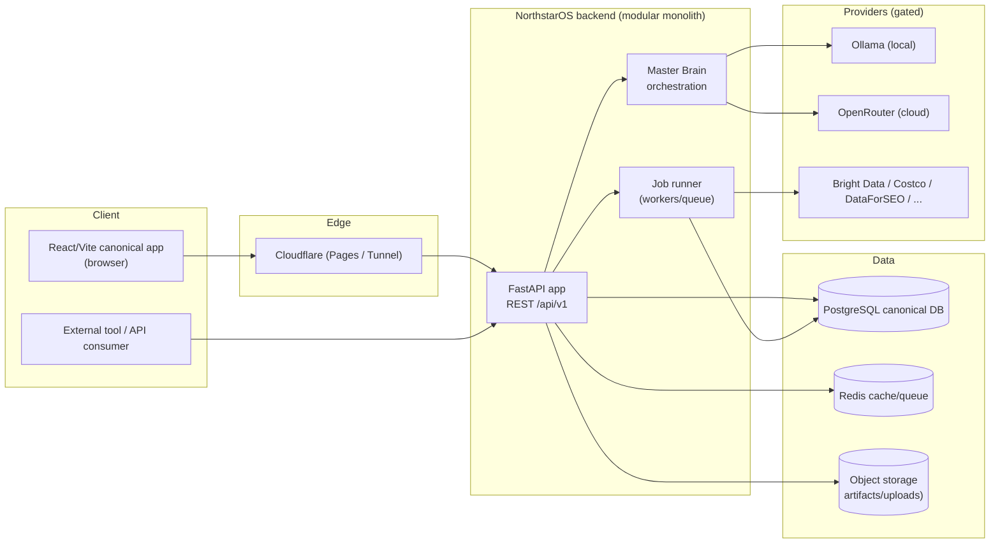

# 01 — Target Architecture

Evidence states: STATICALLY_CONFIRMED (S) / RUNTIME_CONFIRMED (R) / HISTORICALLY_RECORDED (H) / INFERRED (I) / UNKNOWN (K). This is a SPECIFICATION, not implementation.

## 1. System context

**Decision:** modular monolith (FastAPI + Postgres + Redis). Phase 0 found no evidence requiring independently deployed services; microservices are not introduced for appearance (owner decision `00`).

## 2. Module boundaries

| Module | Ownership | Public interface | DB ownership | Events emitted | Events consumed | Background jobs |
|---|---|---|---|---|---|---|
| **identity** | orgs, users, roles, sessions, invites | `/api/v1/auth/*`, `/api/v1/orgs/*` | `orgs`, `users`, `sessions`, `roles`, `memberships` | `user.created`, `session.revoked`, `org.changed` | `tenant.*` | none |
| **catalog** | marketplace, brands, products, identifiers, variations, pack config | `/api/v1/products/*`, `/api/v1/catalog/*` | `marketplace`, `catalog_product`, `product_identifier`, `variation_*`, `pack_config` | `product.created`, `product.updated`, `identity.merged` | `provider.snapshot.ingested` | identity reconciliation |
| **normalization** | unit/pack/variation normalization, dedupe | internal service (no public routes) | shared with catalog | `normalization.done` | `product.created` | — |
| **supplier** | suppliers, accounts, products, offers, invoice/doc status | `/api/v1/suppliers/*` | `supplier`, `supplier_account`, `supplier_product`, `supplier_offer_snapshot`, `invoice_status` | `supplier.ingested`, `supplier.offer.updated` | `product.identity.resolved` | supplier ingest jobs |
| **market** | offer/seller/demand/rank snapshots | `/api/v1/market/*`, `/api/v1/products/{pid}/snapshots` | `offer_snapshot`, `seller_offer_snapshot`, `demand_snapshot`, `rank_snapshot` | `snapshot.recorded` | `provider.record.completed` | snapshot capture jobs |
| **economics** | fee snapshots, product economics | `/api/v1/economics/*` | `fee_snapshot`, `product_economics_snapshot` | `economics.computed` | `snapshot.recorded` | recompute on snapshot |
| **opportunity** | assessments, scoring | `/api/v1/opportunities/*` | `opportunity_assessment` | `opportunity.assessed` | `economics.computed`, `market.snapshot` | scoring job |
| **keyword** | keywords, observations, SEO graph | `/api/v1/keywords/*` | `keyword`, `keyword_observation`, `keyword_association` | `keyword.observed` | `snapshot.recorded` | keyword refresh |
| **listing** | listings, drafts, versions, approval | `/api/v1/listings/*` | `listing`, `listing_version`, `listing_approval` | `listing.drafted`, `listing.approved`, `listing.published` | `keyword.observed`, `brand.voice` | — |
| **advertising** | campaigns, entities, performance | `/api/v1/advertising/*` | `advertising_entity`, `ad_performance_snapshot` | `campaign.changed` | `keyword.observed`, `economics.computed` | ads sync (gated) |
| **social** | assets, campaigns, content, calendar | `/api/v1/social/*` | `social_asset`, `social_campaign`, `social_content` | `social.drafted`, `social.approved`, `social.published` | `brand.voice` | publish queue (gated) |
| **monitoring** | watch configs, alerts, thresholds | `/api/v1/monitoring/*` | `watch_config`, `alert` | `alert.raised`, `watch.triggered` | `market.snapshot`, `listing.changed` | watch evaluation |
| **rival** | competitor entities, observations | `/api/v1/rival/*` | `competitor`, `competitor_observation` | `rival.observed` | `market.snapshot`, `keyword.observed` | rival eval |
| **ai_orchestration** | Master Brain, runs, tools, artifacts | `/api/v1/brain/*` | `brain_run`, `brain_tool_invocation`, `brain_artifact`, `brain_approval` | `brain.run_started`, `brain.step_completed`, `brain.approval_required` | all domain events | run executor |
| **provider** | registry, gates, budgets, fallbacks | `/api/v1/providers/*` | `provider_registry`, `provider_budget`, `provider_gate` | `provider.status_changed`, `provider.budget_exhausted` | `provider.call.requested` | — |
| **usage** | usage events, pricing policy | `/api/v1/usage/*`, `/api/v1/billing/*` | `usage_event`, `pricing_policy`, `invoice` | `usage.event.recorded`, `credits.adjusted` | `provider.call.completed`, `brain.step_completed` | invoice gen |
| **notifications** | delivery, preferences | `/api/v1/notifications/*` | `notification`, `notification_preference` | — | all alerts | notifier |
| **approvals** | queues, grants | `/api/v1/approvals/*` | `approval_request`, `approval_grant` | `approval.requested`, `approval.granted` | brain.approval_required, listing/social/publish events | — |
| **audit** | unified event store | `/api/v1/audit/*` | `audit_event` | — | ALL events (subscriber) | retention |
| **help** | tours, help content | `/api/v1/help/*` | `tour_completion`, `help_content` | `tour.completed` | user.created | — |

## 3. API boundaries

- Public REST: `/api/v1/*` behind FastAPI. Versioned. All responses carry provenance where data-bearing.
- Legacy compatibility: Phase 0 endpoints (`/api/kirkland/*`, `/api/sourcescout/*`, `/api/golden-goose/*`, `/api/autothink/*`) remain served during migration behind the `bff/v1` envelope; new canonical endpoints are additive. Legacy read compatibility is part of the migration plan (`03`).
- No normal GET triggers provider calls, writes, enrichment, or credit debits (owner decision `00`).

## 4. Database ownership

- Single canonical PostgreSQL database; each module owns its tables (table-prefix or schema per module). Redis for cache + queue + rate-limit.
- Cross-module reads only via module public interface or read-model views; no direct cross-module table writes.
- All writes to external providers happen ONLY in job/command context with an audit + usage event; never in a GET path.

## 5. Events and idempotency

- Every module emits events (catalog `24-event-catalog.md`). Events are the integration backbone between modules.
- All writes are idempotent: idempotency keys on creation endpoints; `usage_event` carries its own idempotency key; provider calls carry request idempotency.
- Failure handling: circuit breaker on providers; dead-letter queue for jobs; retries bounded and never silent.

## 6. Synchronous vs asynchronous

| Work | Mode | Why |
|---|---|---|
| Reads of canonical DB | sync | low latency |
| Product identity reconciliation | async (job) | batch, non-blocking |
| Provider snapshot capture | async (job, gated) | slow, rate-limited |
| Economics recompute | async (job) after snapshot | batch |
| Opportunity scoring | async (job) | batch over candidates |
| LLM generation (AutothinK, generators) | async (run + SSE/WebSocket progress) | seconds-scale |
| External writes (listing/ads/social/purchase) | async approval flow | requires approval + audit |
| Notifications/alerts | async (queue) | fan-out |

## 7. Observability

- Structured JSON logs with request_id; error-rate tracker (extend `error_alerts.py`); provider call telemetry (usage events double as cost telemetry); business KPIs in Hub (read-model).
- Health: `/health`, `/health/detailed` per-module readiness.

## 8. Security posture (carried from `05`)

- AuthN: JWT (access/refresh) + sessions. AuthZ: RBAC + resource-level ownership.
- Environment + view-context guards at middleware; no production writes from sandbox/preview.
- Rate limits per org/plan (Redis-backed), prod-posture guard retained.

## 9. Deployment

- FastAPI app containers; job workers; Postgres (RDS/CloudSQL or Supabase per owner Q3); Redis; object storage for artifacts.
- Frontend: built `dist/` served either by FastAPI static mount (Phase 1B decision documented in `08`) or dedicated host; Cloudflare Tunnel/Pages retained.
- No deployment changes are performed in Phase 1A.

## 10. What this resolves from Phase 0

- R1 (product identity) → module `catalog` + `03`.
- R15 (modes) → `05`.
- R4 (billing) → `07`.
- R20 (frontend) → `08`.
- R2/R13/R14 (dormant intelligence + formula duplication) → `catalog`, `keyword`, `economics` modules + `13`/`17` service specs.
- R3 (no scheduler) → job runner + monitoring module.
- R5 (GG two-gate) → provider/approvals modules.
- R7 (orphaned adapters) → provider module adopts selected adapters or deletes orphans in Phase 1B.
