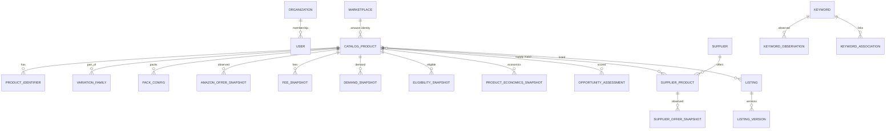

# 02 — Canonical Domain Model

Evidence states: STATICALLY_CONFIRMED (S) / RUNTIME_CONFIRMED (R) / INFERRED (I). This is the Phase 1B data model SPECIFICATION.

## 1. Canonical entity set (owner decision `00`)

Every entity below preserves the provenance attributes defined in §3.

### Identity
- `organization` — tenant container.
- `user` — account.
- `membership` — user↔org with role (`customer|operator|admin`).
- `session` — auth session.
- `invite` — org invite.

### Product catalog
- `marketplace` — `(marketplace_id, name, domain, region)`.
- `catalog_product` — the canonical product row, keyed by immutable `product_id` (UUID).
- `product_identifier` — ASIN, UPC, EAN, GTIN, MPN; raw + normalized; `(kind, value, marketplace_id)` with uniqueness.
- `brand` — brand entity.
- `variation_family` — family grouping.
- `variation_child` — child relationship within family.
- `pack_config` — pack composition (count, unit, unit_type, is_multipack, is_bundle).
- `unit_normalization` — canonical unit math (count, unit_of_measure, per-unit weight).
- `amazon_offer_snapshot` — observed Amazon offer at a time.
- `seller_offer_snapshot` — per-seller offer observation.
- `fee_snapshot` — computed fee stack at a time.
- `demand_snapshot` — BSR→sales estimate observation.
- `rank_snapshot` — keyword/BSR position observation.
- `eligibility_snapshot` — eligibility determination at a time.
- `product_economics_snapshot` — net/ROI/margin at a time (fee + cost basis).
- `opportunity_assessment` — scored opportunity.

### Supplier
- `supplier` — company.
- `supplier_account` — credential/account per supplier.
- `supplier_product` — supplier SKU record.
- `supplier_offer_snapshot` — supplier price/availability observation.
- `invoice_status` — invoice/documentation state per product-supplier (never implied by retail receipt).

### Intelligence
- `keyword` — normalized keyword.
- `keyword_observation` — volume/rank/performance observation.
- `keyword_association` — keyword↔listing/campaign/competitor.
- `listing` — listing record.
- `listing_version` — audited versions.
- `advertising_entity` — campaign/ad group/ad.
- `social_asset` — media asset.
- `social_content` — post draft/approved/published.
- `watch_config` — monitoring thresholds.
- `competitor` — competitor entity.
- `competitor_observation` — rival snapshot.

### Ops
- `provenance_record` — provenance trail.
- `refresh_job` — capture/enrichment job record.
- `audit_event` — unified audit.
- `usage_event` — metered usage (see `07`).
- `approval_request` / `approval_grant` — approval workflow.

## 2. Product identity rules

- **Global key:** `product_id` (UUID, immutable).
- **Amazon uniqueness:** `(marketplace_id, asin)` unique.
- **Multipack/bundle/variation:** separate `pack_config`/`variation_*` rows — NEVER collapsed into the parent product row.
- **Identifier normalization:** ASIN uppercase trim; UPC/EAN/GTIN digit-normalized (strip spaces/check-digit handling on import, raw preserved).
- **Cross-marketplace:** same ASIN in another marketplace = distinct Amazon identity sharing `product_id` via identifier resolution or a distinct `product_id` if truly different products — resolved by the identity reconciliation job.

## 3. Provenance model (every normalized relationship)

| Attribute | Type | Meaning |
|---|---|---|
| `source` | enum | provider / import / user / computed / derived |
| `source_identifier` | str | provider record id / import row ref / run id |
| `captured_at` | timestamptz | when observed |
| `effective_at` | timestamptz | business-effective time (default = captured) |
| `confidence` | float 0..1 | model/parser confidence |
| `verification_state` | enum | `unverified / pending / verified / failed` |
| `raw_source_ref` | str | pointer to raw payload/evidence file |
| `transformation_version` | str | normalizer/parser version that produced the value |
| `staleness_state` | enum | `fresh / stale / unknown_age / unavailable` |

## 4. Snapshot pattern

All `*_snapshot` entities are append-only time-series keyed to a parent entity + `captured_at`. Example: `amazon_offer_snapshot(product_id, marketplace_id, captured_at, price, availability, ...)`.
- Old snapshots are never mutated.
- Latest-value reads go through a materialized "current" projection or `DISTINCT ON (parent)` query.
- Freshness per Phase 0 conventions (offers 7d / sales 30d / identity 90d; catalog refresh window).

## 5. Unit / pack normalization rules

- Parse pack from title/SKU into `pack_config`: count, unit, unit_type, multipack flag, bundle flag.
- Ambiguous packs → `pack_config.verification_state = pending` and deferred to review; NEVER force a guess.
- `unit_normalization` stores per-unit canonical weight/measure so size/weight filters operate on normalized units.

## 6. Economics model

- `fee_snapshot`: referral fee, FBA fee, fuel surcharge, inbound, prep, packaging, return reserve + `fee_rule_version` (Phase 0 `amazon_us_fee_rules_2026.py` rules versioned).
- `product_economics_snapshot`: cost basis (source + confidence), net, ROI, margin with the **single canonical margin definition** (`net / sale price`) and the **single canonical ROI** (`net / landed cost`) — resolving Phase 0 R13/R14 duplication.
- Economics never computes without identified cost + fee basis (owner rule: ROI not decision-ready without basis).

## 7. Keyword/SEO graph (shared)

- `keyword` normalized; `keyword_observation` per source (Amazon search terms, Ads SQR, competitor listing scrape) with volume/rank/performance + provenance + confidence.
- `keyword_association` links keyword → listing, campaign, competitor — the SINGLE keyword universe consumed by OfferChisel, Auctioneer, Town Crier, RankLedger, Rival Board (Phase 0 R2 resolution).

## 8. Entity-relationship sketch

## 9. Counts / evidence

- This model replaces the Phase 0 four-store divergence (`products` table, `scanner-search-cache*.json`, `sourcescout_manifest.json`, `goose_scan_*.json`) — field mapping in `03`.
- All entity names and provenance attributes follow owner decision `00` exactly.
