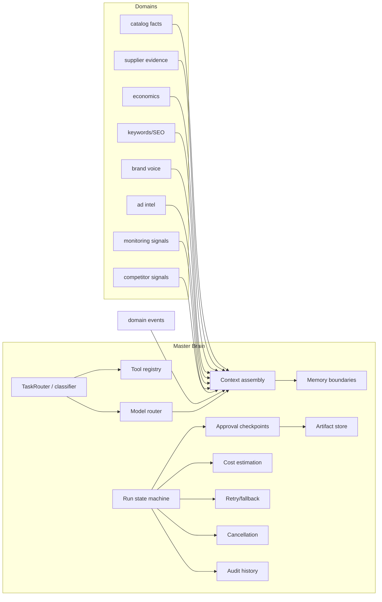

# 04 — Master Brain Specification

Evidence states: STATICALLY_CONFIRMED (S) / RUNTIME_CONFIRMED (R) / INFERRED (I). Specification only.

## 1. Role

Master Brain = **orchestration and shared intelligence** — NOT an unrestricted superuser.

It coordinates: product facts, supplier evidence, economics, keywords, SEO intelligence, brand voice, advertising intelligence, monitoring signals, competitor signals, recommendations, automation runs.

It must NEVER bypass: permissions, approval gates, data provenance, cost limits, provider policy, audit logging, production-write restrictions.

## 2. Components

### TaskRouter / classifier
- Reuse Phase 0 `master_brain_gateway.classify_task` (deterministic, rules-based) as the base; extend with domain intents for the 11 services.
- Deterministic classification first; LLM classification only where rules are insufficient (and never for authorization decisions).

### Tool registry
- Registered tools per module (e.g., `catalog.lookup`, `supplier.match`, `economics.compute`, `keyword.research`, `listing.generate_draft`, `ad.build_plan`, `social.draft_caption`, `monitoring.check`, `brain.run_workflow`).
- Each tool entry: id, module, input/output contract, permission requirement, provider requirement, cost model, idempotency, safety class (`read | draft | write_external | purchase`).

### Model router
- Reuse `model_router.py` tier/consent logic. Local (Ollama) default; cloud (OpenRouter) gated by `CLOUD_MODEL_LIVE=1` + per-org provider config.
- Tier escalation T1→T2→T3 with consent; downgrades never auto.

### Context assembly
- Build run context from canonical stores + domain events (product facts, supplier evidence, economics, keywords, brand voice, monitoring signals, competitor signals).
- Never includes secrets or tenant-crossing data.

### Memory boundaries
- Per-organization memory (memory bank per org), with provenance + retire/unlearn. No cross-tenant leakage.
- Local embeddings planned (Phase 0: none exist); memory search remains DB-backed in Phase 1B.

### Run state machine
- `brain_run` states: `queued → planning → running → awaiting_approval → paused → completed | failed | cancelled`.
- Resumable; intermediate results persisted as `brain_step` rows.

### Artifact store
- Files (generated listings, captions, plans, reports) stored in object storage; metadata in DB; downloadable via signed/authorized route.

### Approval checkpoints
- Tool safety class `write_external`/`purchase` → `awaiting_approval`; approval request emitted (`24-event-catalog.md`).
- Reauthorization required for sensitive actions even during preview.

### Cost estimation
- Estimate before run (tokens/credits per step); enforce budget cap from pricing policy (`07`); stop on cap exhaustion (circuit breaker).

### Retry / fallback
- Bounded retries; provider fallback chain from provider registry; never auto-retry a failed live write; never substitute fabricated values.

### Cancellation
- Cancel signal sets `paused`/`cancelled`; in-flight provider calls bounded by timeout; partial results preserved.

### Audit history
- Every run, step, tool invocation, approval, cost, and artifact linked to `audit_event` (unified audit) — no silent LLM in deterministic paths (per `shared/master-brain/constitution.json`).

## 3. AutothinK evolution

- AutothinK UI becomes a surface of the canonical React app (`08`); backend run model maps onto `brain_run`.
- Single textarea → agentic workbench: natural-language objective → plan → tool selection → multi-step execution → artifacts → approval checkpoints → timeline.
- Cloud providers = expected customer path; local = internal/dev path (owner directive).

## 4. What is NOT in scope for Master Brain

- Bypassing RBAC, gates, budgets, provenance, provider policy, audit, or write restrictions.
- Unrestricted impersonation; cross-tenant access.
- Authoritative market data creation (it may only present evidence-backed data with provenance).
