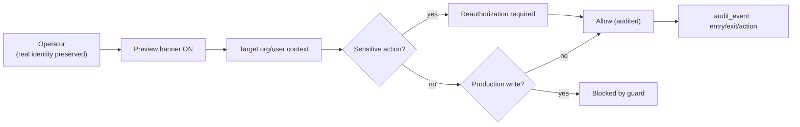

# 05 — Permissions and Modes

Evidence states: STATICALLY_CONFIRMED (S) / INFERRED (I). Specification only.

## 1. Three orthogonal control dimensions (owner decision `00`)

| Dimension | Values | Implemented as |
|---|---|---|
| ENVIRONMENT | `sandbox` / `production` | per-request environment context (tenant-scoped, not a global toggle) |
| ROLE | `customer` / `operator` / `admin` | RBAC role per membership |
| VIEW CONTEXT | `normal` / `audited_customer_preview` | preview context record attached to the operator session |

## 2. RBAC

| Role | Capabilities |
|---|---|
| `customer` | Use services within plan; view own org data; create drafts; request approvals; no admin/ops controls |
| `operator` | Customer capabilities + operate jobs/refresh (within gates), manage org settings, view audit for own org, preview customer view (audited) |
| `admin` | Operator + platform/org admin: plans, teams, provider registry for org, impersonation-free preview, audit queries, security settings |

- Phase 0 `auth.py` already has roles member/operator/owner/admin and `tenant_id` in tokens — extend to `customer/operator/admin` naming with org membership.
- Resource-level checks: org-scoped data access via `membership`; never cross-tenant.
- `require_role`, `require_org_admin`, `require_environment("production")` guards (reuse `auth_deps.py` patterns).

## 3. Environment mode

- `sandbox` vs `production` is a **tenant-scoped** setting (and a deploy-time env for the app itself).
- Sandbox: provider calls routed to mock/sandbox harnesses only; external writes disabled; data labeled `sandbox`.
- Production: full gates apply; live writes require approvals.
- Mode is attached to request context and checked by middleware — no global cosmetic toggle.

## 4. Audited customer preview (NO impersonation)

- Operator opens preview with explicit target `(org, user)` context; the operator's real identity is preserved in the session; a `preview_context` is attached.
- Persistent, non-dismissable banner showing "Previewing as <customer org/user>".
- Guards:
  - Production writes blocked while previewing (route-level + write-guard).
  - Sensitive actions require reauthorization (re-entry of operator token/password).
  - Entry, exit, and every action logged to `audit_event`.
  - Secrets/credentials never surfaced.
- **No unrestricted identity impersonation** in Phase 1 (owner decision `00`).

## 5. Approval gates

- `approval_request`/`approval_grant` records. Gates required for: external writes (listing publish, ads changes, social publish), purchases (manual), provider live scans beyond budget, elevated cost actions.
- All gates are per-scope, budgeted, revocable; grant references scope + limits + provider.

## 6. Data-label rules under modes

- Data always carries provenance label (live/cached/imported/estimated/calculated/mocked/stale/unavailable).
- Sandbox data never presented as production; preview never presents operator data as customer data.

## 7. Consequence matrix

| Action | Sandbox | Production | Preview |
|---|---|---|---|
| Read canonical DB | OK | OK | OK (customer-scoped) |
| Local LLM generation | OK (credited as local) | OK | OK |
| Provider live read | mock only | requires gate+budget | blocked unless operator-approved + audited |
| Draft create | OK | OK | OK |
| External write | blocked | requires approval | blocked |
| Purchase | blocked (manual) | manual + approval | blocked |

## 8. What this resolves

- Phase 0 R15 (no mode architecture) and R10 (anonymous demo fallback): production requires auth; sandbox is explicit.
- Phase 0 `12` findings: distinction of authN/authZ/tenancy/admin/operator/customer/env/sandbox/production/preview/impersonation.
