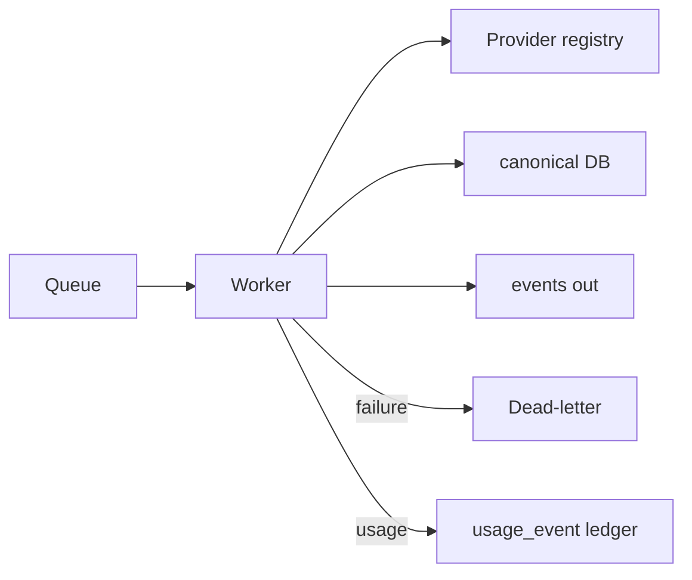

# 06 — Provider and Job Architecture

Evidence states: STATICALLY_CONFIRMED (S) / RUNTIME_CONFIRMED (R) / HISTORICALLY_RECORDED (H) / INFERRED (I). Specification only; no provider invoked.

## 1. Provider registry (canonical)

Replaces the ad-hoc env-gate sprawl from Phase 0 with a DB-backed registry:

| Field | Meaning |
|---|---|
| provider_id | stable id (e.g., `bright_data_web_unlocker`) |
| name, category | discovery/enrichment/ads/social/ai/voice/image |
| adapter_module | Phase 0 module to adopt (or new) |
| credential refs | **names only** — actual values stay in secret store/env, never in DB |
| gate | enable/disable per org + env (sandbox/production) |
| budget | per-provider cap (calls, credits, USD) |
| fallback chain | ordered fallbacks |
| rate_limit | rpm/rpd |
| timeout | sec |
| status | ok/degraded/blocked/disabled |
| cost_model | per-call/credit model |
| last_success | mechanism (health check + run ledger) |
| sandbox_support | mock/sandbox endpoint or harness |

## 2. Provider gate rules (owner decision `00`)

- **No normal GET / page load triggers any provider call.** Live provider use is: explicit, observable, budgeted, rate-limited, logged, controllable.
- Live reads require an opened gate + budget; live writes require approval + audit.
- Failures never fabricate values; circuit breaker per provider.

## 3. Job architecture

- Job runner (worker) consumes a queue (Redis/RQ in Phase 1B; may move to proper broker).
- Job types: refresh/snapshot capture, identity reconciliation, economics recompute, opportunity scoring, keyword refresh, watch evaluation, invoice gen, provider budget checks.
- Every job: `refresh_job` row (id, type, status, params, started_at, finished_at, result_summary, error, credits_used, environment), idempotent by (type, scope key), bounded retries with dead-letter.

## 4. Provider adapter adoption (from Phase 0 orphans)

| Phase 0 module | Decision |
|---|---|
| `bright_data_client.py` (Web Unlocker) | ADOPT (primary discovery) |
| `brightdata_client.py` (legacy dataset) | DEPRECATE (keep behind provider=legacy for compat) |
| `bright_data_costco.py`, `firecrawl_costco.py` | ADOPT as Costco detail adapters (failover pair) |
| `costco_client.py`, `costco_api_client.py` | ADOPT (CSV + catalog) |
| `dataforseo_adapter.py` | ADOPT (guarded validation) — fix import-time credential capture (Phase 0 R17) |
| `easyparser_client.py` | ADOPT (offer roster) |
| `scavio_client.py`, chocodata (in amazon_search) | ADOPT as search fallbacks |
| `unwrangle` (in offer_enrichment) | KEEP CODE, mark blocked; re-validate under approved envelope (Phase 0 R8) |
| `adapters/` package (brightdata/firecrawl/easy_parser/open_web_ninja/scrape_do/amazon_api) | DECIDE in Phase 1B: adopt patterns into registry adapters OR delete orphans (Phase 0 R7). Recommendation: DELETE the dead `adapters/*` duplicates; keep SP-API/Ads importers behind a phase-gated feature if owner wants Ads/SP-API in scope. |
| `rapidapi_client.py`/`rapidapi_router.py` | KEEP CLI tooling; not a default path |
| `canopy_client.py` | KEEP optional |
| SP-API / Ads importers | OWNER DECISION Q5/Q6 — unwired today; do not activate in Phase 1B without approval |

## 5. Rate limiting + cost

- Redis-backed rate limit per org+plan+provider (replaces in-memory Phase 0 limiter for multi-worker safety — Phase 0 R12).
- Provider budget checks before every call; usage_event recorded after every call (Phase 0 R4/R9 linkage).

## 6. Failure handling

- Circuit breaker (provider status flap), bounded retries, dead-letter queue, error alerting (extend `error_alerts.py`), never silent fallback to fabricated data.
- Provider-failure state surfaced in UI (see service specs).

## 7. Observability

- Every provider call → usage_event + audit_event + telemetry; per-provider error rate dashboard in Hub.
