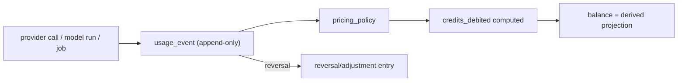

# 07 — Usage, Billing, and Credit Ledger

Evidence states: STATICALLY_CONFIRMED (S) / RUNTIME_CONFIRMED (R) / INFERRED (I). Specification only.

## 1. Principles (owner decision `00`)

- **Append-only usage-event ledger.** Never derive consumption from a mutable balance field.
- Balance is always a **derived projection** over ledger entries (grant − consumed + adjustments).
- Credit→USD conversion NOT finalized; a configurable pricing-policy layer governs all charging.
- Free local execution (Ollama) is supported; failed-run charging rules defined by policy.
- Every metered event supports reversal/adjustment + idempotency + provenance + environment.

## 2. Usage event schema

| Field | Type |
|---|---|
| usage_event_id | uuid |
| organization_id | uuid |
| user_id | uuid |
| service | enum (11 services + brain) |
| workflow_run_id | uuid (brain_run / job) |
| provider | provider_id |
| model_or_endpoint | str |
| input_units | bigint |
| output_units | bigint |
| provider_reported_cost | numeric (nullable, delayed) |
| estimated_cost | numeric (nullable) |
| credits_debited | numeric |
| event_status | `pending / finalized / reversed / adjusted` |
| idempotency_key | str unique |
| occurred_at | timestamptz |
| reversal_ref | uuid nullable |
| provenance | jsonb |
| environment | sandbox/production |

## 3. Pricing policy layer

| Policy concept | Behavior |
|---|---|
| provider_cost | recorded from provider or estimated |
| platform_markup | multiplier/add-on |
| minimum_charge | floor per event/run |
| included_monthly_credits | per plan (from `shared/subscription-plans.json` + org) |
| promotional_credits | granted entries |
| service_multiplier | per-service weight |
| free_local_execution | local provider events = 0 credits (still recorded) |
| failed_run_rule | configurable: charge/refund/partial (default: refund, no charge on provider failure) |
| refunds/reversals | adjustment entries with reversal_ref |
| provider_price_versioning | versioned cost table per provider/date |

## 4. Plan tiers (carried from Phase 0)

Foundation / Scout / Mover / AutothinK (`shared/subscription-plans.json`, `PLAN_CREDIT_ALLOTMENT`). Credits remain decoupled from USD until owner confirms conversion (open question Q3).

## 5. Metering wiring (resolves Phase 0 R4)

- Every provider call, model run, and billable job appends a `usage_event` (in the same transaction as the call/job result or via outbox).
- `usage_meter.py` (Phase 0) becomes a projection over `usage_event`; it no longer needs a standalone counter store.
- Ledger engine (`credit_ledger.py`) gains a DB-backed append-only table + idempotent debits tied to `usage_event_id`.
- Dashboard (Ledger/Hub) reads projections only.

## 6. Invoices & overage

- `invoice` derived from finalized usage per billing period; refunds as reversal entries.
- Overage rules per policy; alerts at thresholds (notification module).

## 7. What this resolves

- Phase 0 R4 (credits display-only; balance==allotment) → real metered consumption.
- Phase 0 ledger/meter separation → single event-driven flow.
- Owner decision `00` §3 exactly.
