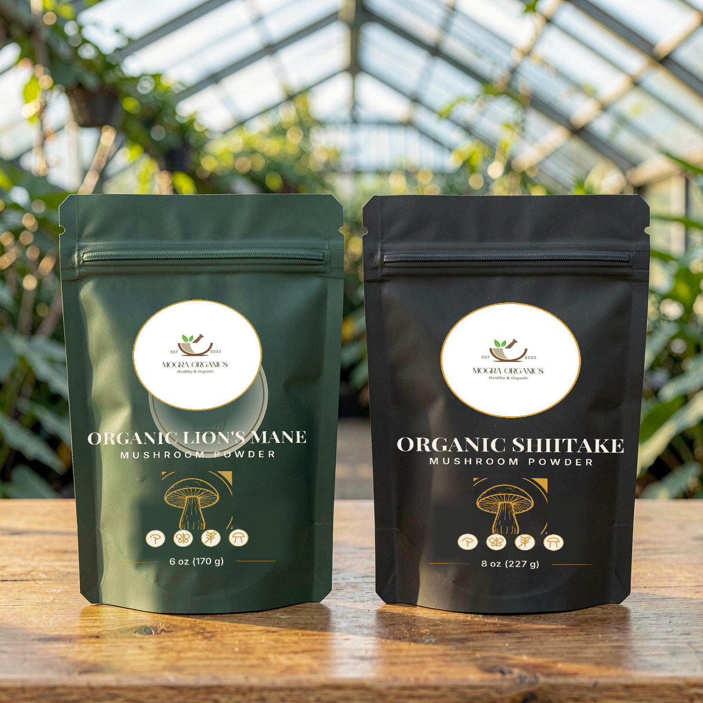
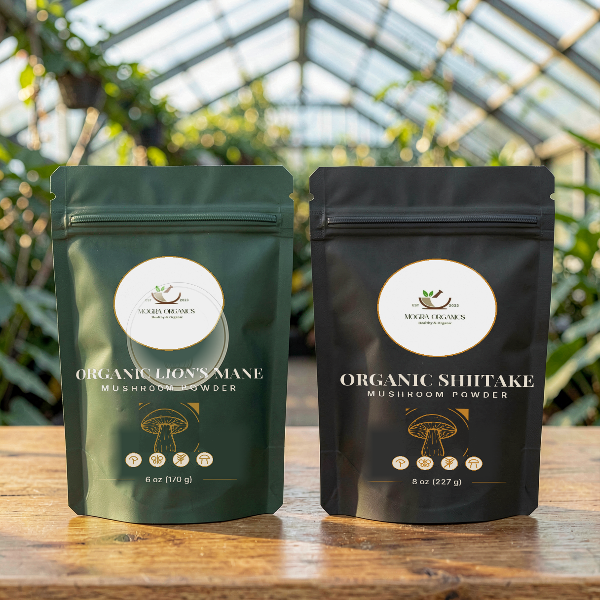
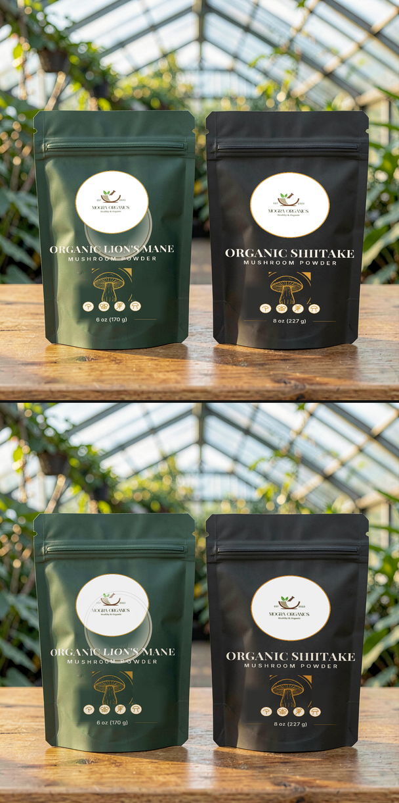
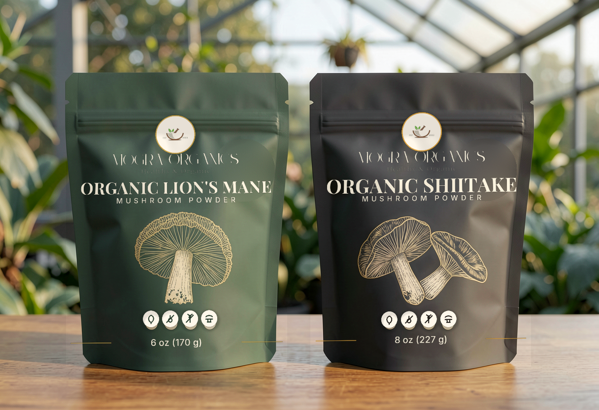
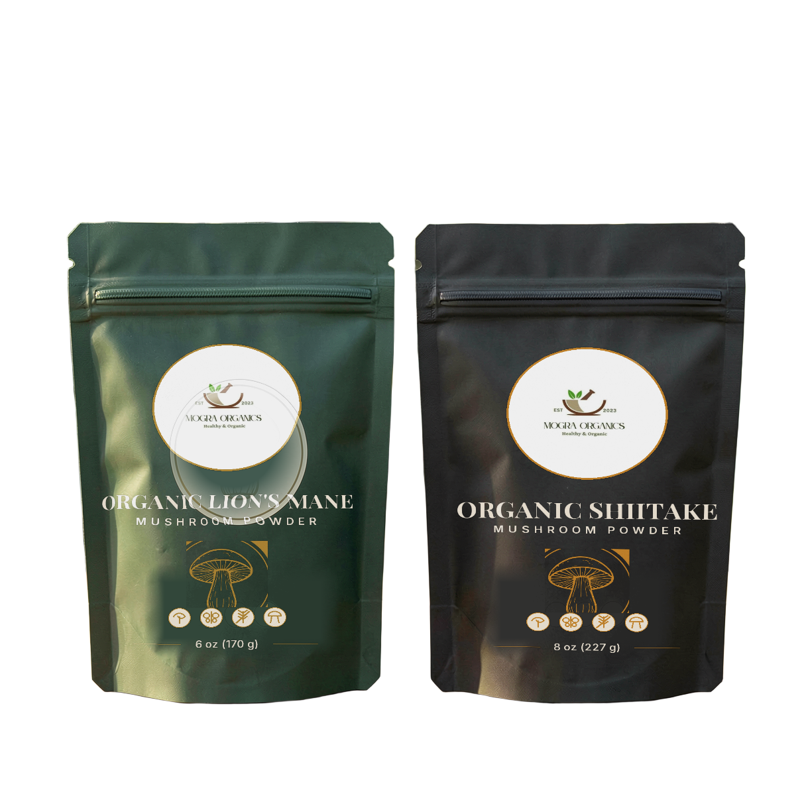
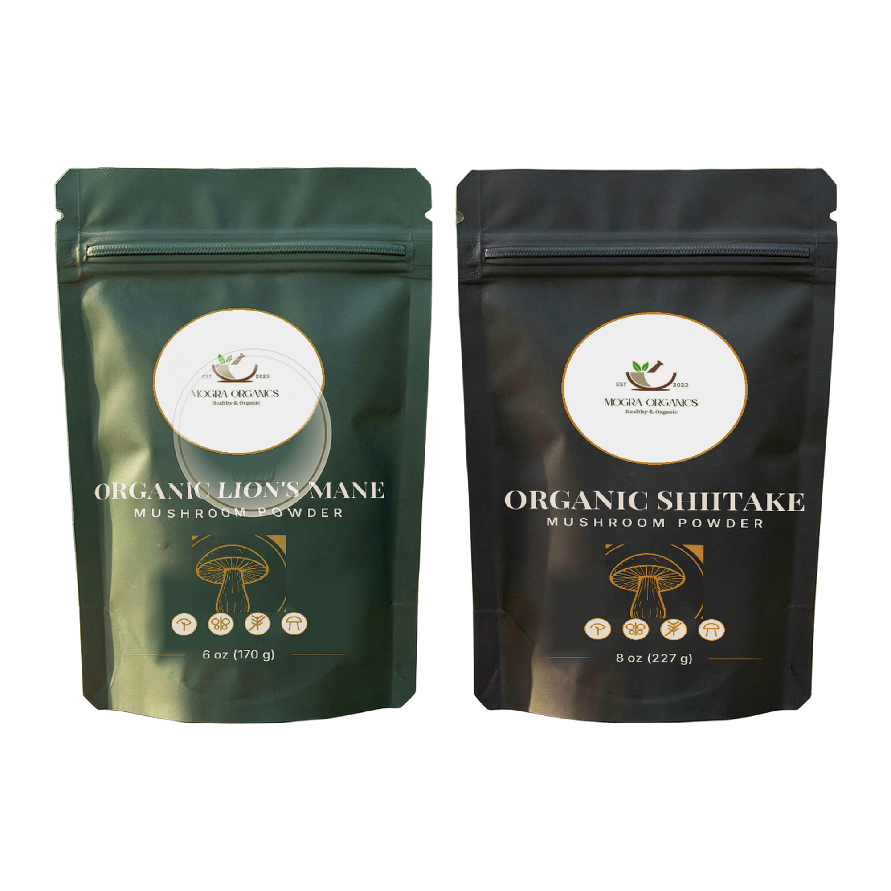

# renders-root — review pack, 20261109

This slice of `staging-candidate/20261109-0158` touches 8 commit(s) ahead of `main` and changes **16 path(s)**, 16 of which render. It is refused for auto-promotion (`slice_visual`): a person has to look at these images first.

- candidate `staging-candidate/20261109-0158` @ `433c5d87d5ef`
- target `main` @ `ecef24a75d92`

## Gates

| gate | result | evidence |
|---|---|---|
| suite | FAIL | candidate staging-candidate/20261109-0158 = 433c5d87d5ef summary: 32 failed, 7189 passed, 125 skipped, 2 xfailed, 17 warning, 125 subtests |
| verifier | FAIL | d15_verification.md: 17 agree, 2 FAILED, 1 BLOCKED reproduced by: not recorded (--verifier not given) |
| slice | FAIL | slice renders-root: 16 path(s), 10 image(s) rendering paths: 16 |

Refused by: `suite`, `verifier`, `slice`

## Images (10 of 5–10)

Slice images first, then committed evidence as context. `before` shows the same path on the target branch; a blank before means the file is new here.

| after (this slice) | before | where |
|---|---|---|
| `renders/_ab_crop.png`<br> | _new here_ | this slice |
| `renders/_ab_full.png`<br> | _new here_ | this slice |
| `renders/ab_realism_crop.png`<br> | _new here_ | this slice |
| `renders/ab_realism_flat.png`<br> | _new here_ | this slice |
| `renders/ab_realism_real.png`<br> | _new here_ | this slice |
| `renders/ab_realism_side_by_side.png`<br> | _new here_ | this slice |
| `renders/mogra-forest-dusk-mockup-complete-v1.png`<br> | _new here_ | this slice |
| `renders/mogra-forest-dusk-mockup-complete.png`<br> | _new here_ | this slice |
| `renders/smoke_cutout_alpha.png`<br> | _new here_ | this slice |
| `renders/smoke_main_2000.png`<br> | _new here_ | this slice |

## Scorecard delta

`ty/scorecards.json` is **absent on `main`** — every score is new.

at_bar **2**: hub, prospector

| service | score | at bar |
|---|---|---|
| hub | 100 | yes |
| prospector | 100 | yes |
| ledger | 86.2 | no |
| auctioneer | 86.2 | no |
| autothink | 86.2 | no |
| thewatch | 86.2 | no |
| rankledger | 86.2 | no |
| rivalboard | 86.2 | no |
| account | 86.2 | no |
| foundation | 86.2 | no |
| jobs | 86.2 | no |
| keywords | 86.2 | no |

## Changed paths (16)

```
renders/_ab_crop.png
renders/_ab_full.png
renders/ab_realism.json
renders/ab_realism_crop.png
renders/ab_realism_flat.png
renders/ab_realism_real.png
renders/ab_realism_side_by_side.png
renders/mogra-forest-dusk-mockup-complete-v1.png
renders/mogra-forest-dusk-mockup-complete.json
renders/mogra-forest-dusk-mockup-complete.png
renders/mogra-forest-dusk-mockup.json
renders/package_readiness_live.json
renders/smoke_cutout_alpha.png
renders/smoke_cutout_main.json
renders/smoke_main_2000.png
renders/smoke_qwen_edit_2511.json
```

## Commands

Promote just this slice:

```
python tools/promote_staging.py --source staging-candidate/20261109-0158 --slice renders-root --promote --candidate staging-candidate/20261109-0158 --approve-visual "<what you looked at and accepted>"
```

Revert it:

```
python tools/promote_staging.py --slice renders-root --revert promote/20261109-renders-root-433c5d87
```
