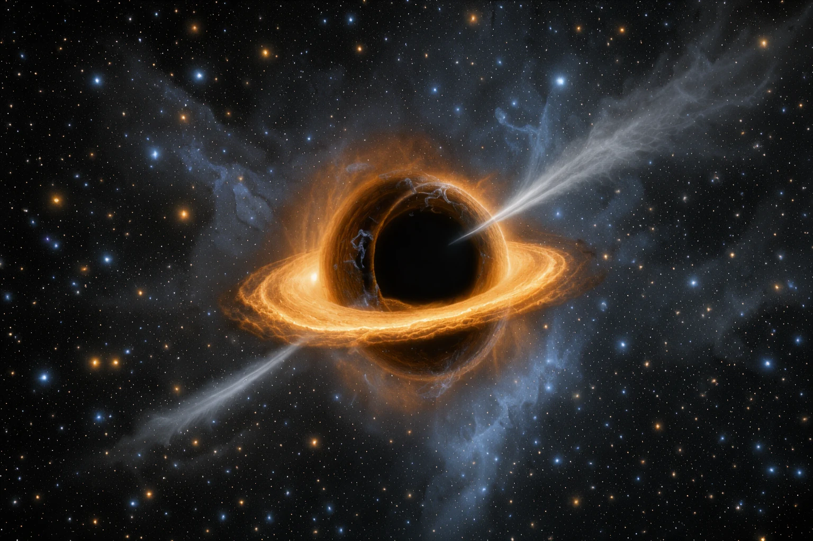
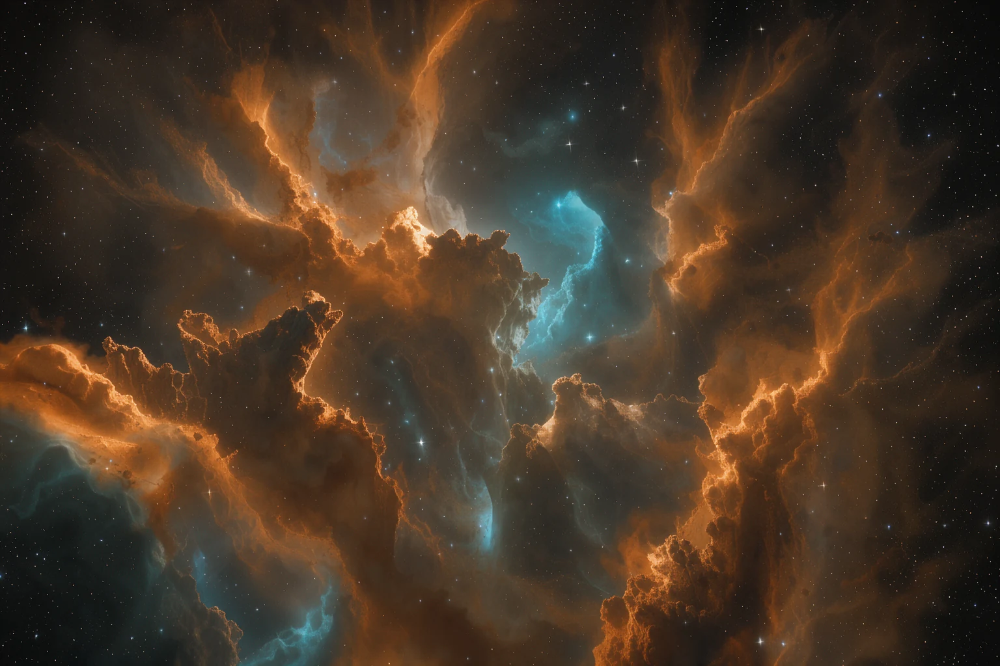
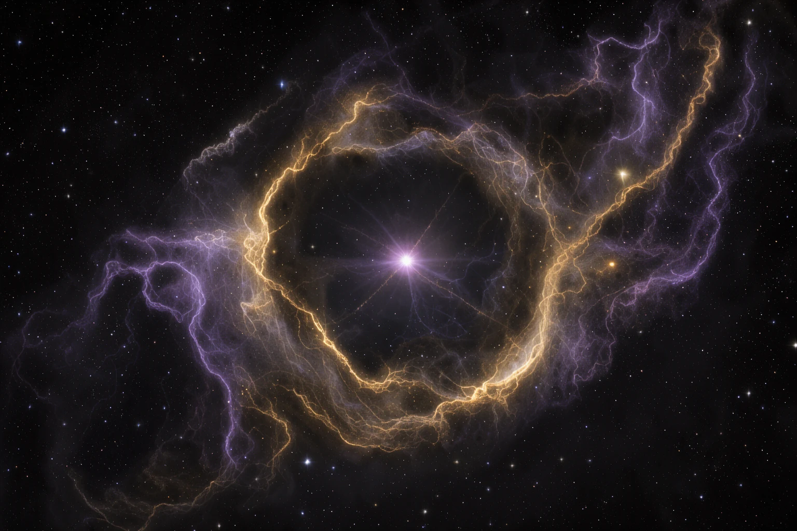
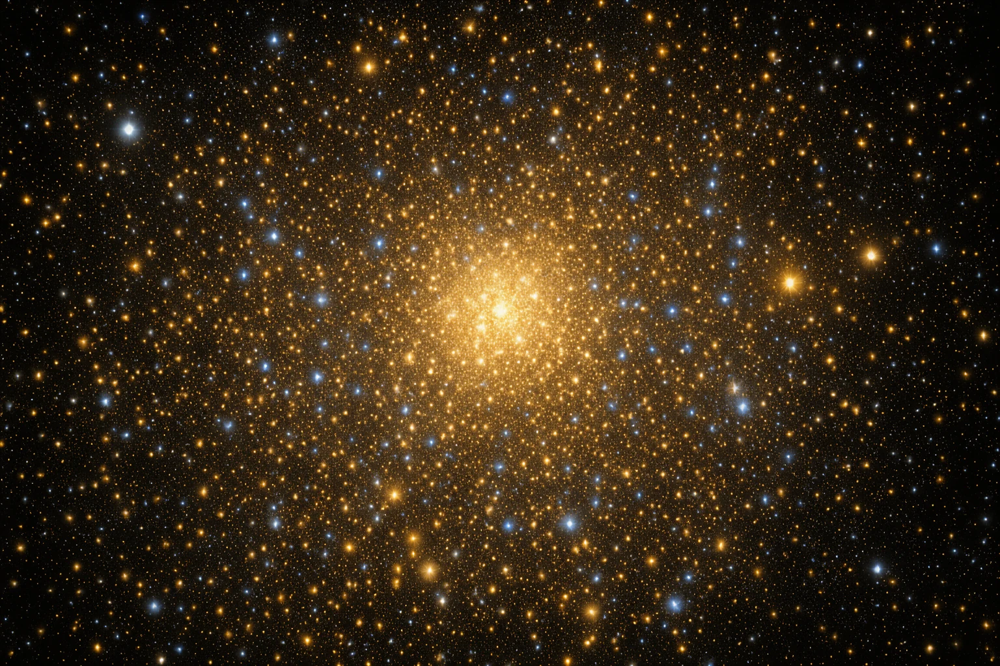
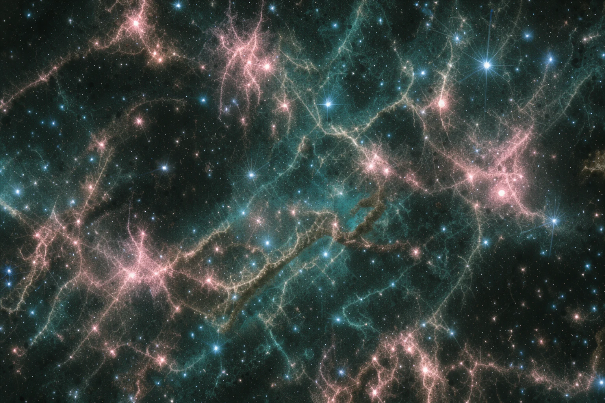
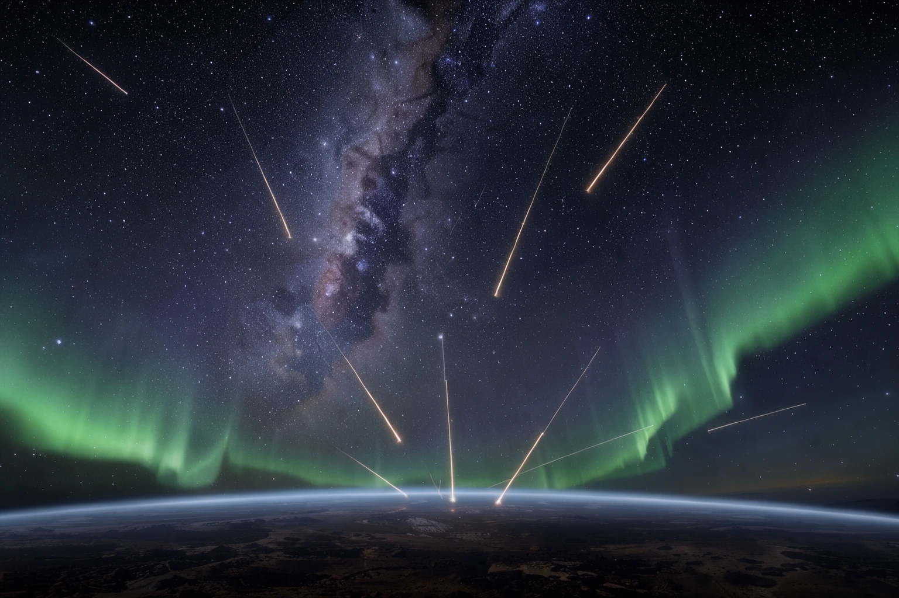
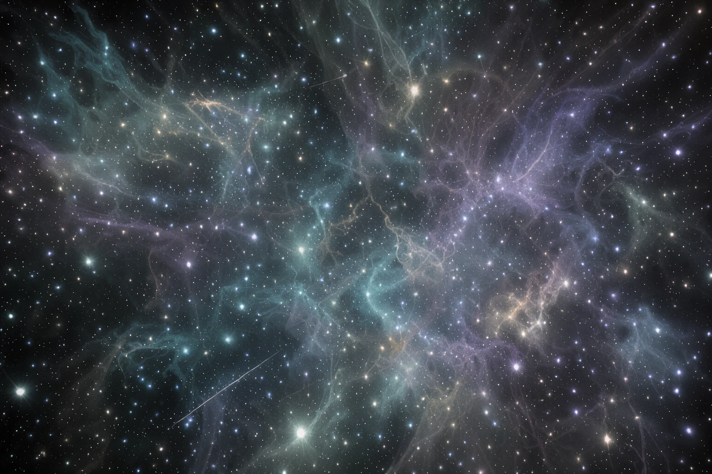
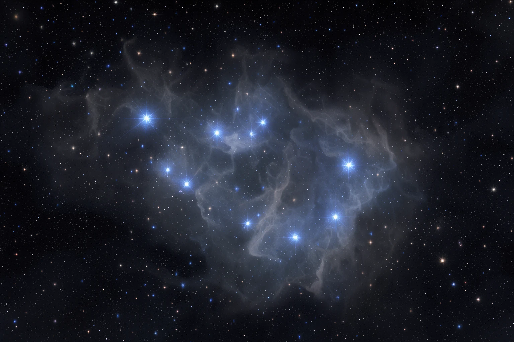

# ui-galactic — review pack, 20261109

This slice of `staging-candidate/20261109-0158` touches 3 commit(s) ahead of `main` and changes **6 path(s)**, 6 of which render. It is refused for auto-promotion (`slice_visual`): a person has to look at these images first.

- candidate `staging-candidate/20261109-0158` @ `433c5d87d5ef`
- target `main` @ `ecef24a75d92`

## Gates

| gate | result | evidence |
|---|---|---|
| suite | FAIL | candidate staging-candidate/20261109-0158 = 433c5d87d5ef summary: 32 failed, 7189 passed, 125 skipped, 2 xfailed, 17 warning, 125 subtests |
| verifier | PASS | d15_verification.md: 17 agree, 2 FAILED, 1 BLOCKED reproduced by: not recorded (--verifier not given) |
| slice | FAIL | slice ui-galactic: 6 path(s), 0 image(s) rendering paths: 6 |

Refused by: `suite`, `slice`

## Images (10 of 5–10)

Slice images first, then committed evidence as context. `before` shows the same path on the target branch; a blank before means the file is new here.

| after (this slice) | before | where |
|---|---|---|
| `northstar-os-ui/src/assets/galactic/andromeda-spiral.webp`<br> | _new here_ | context |
| `northstar-os-ui/src/assets/galactic/black-hole-disk.webp`<br> | _new here_ | context |
| `northstar-os-ui/src/assets/galactic/carina-cliffs.webp`<br> | _new here_ | context |
| `northstar-os-ui/src/assets/galactic/crab-pulsar.webp`<br> | _new here_ | context |
| `northstar-os-ui/src/assets/galactic/globular-core.webp`<br> | _new here_ | context |
| `northstar-os-ui/src/assets/galactic/magellanic-reef.webp`<br> | _new here_ | context |
| `northstar-os-ui/src/assets/galactic/meteor-rain.webp`<br> | _new here_ | context |
| `northstar-os-ui/src/assets/galactic/orion-nursery.webp`<br> | _new here_ | context |
| `northstar-os-ui/src/assets/galactic/pleiades-veil.webp`<br> | _new here_ | context |
| `northstar-os-ui/src/assets/galactic/rose-galaxy.webp`<br> | _new here_ | context |

## Scorecard delta

`ty/scorecards.json` is **absent on `main`** — every score is new.

at_bar **2**: hub, prospector

| service | score | at bar |
|---|---|---|
| hub | 100 | yes |
| prospector | 100 | yes |
| ledger | 86.2 | no |
| auctioneer | 86.2 | no |
| autothink | 86.2 | no |
| thewatch | 86.2 | no |
| rankledger | 86.2 | no |
| rivalboard | 86.2 | no |
| account | 86.2 | no |
| foundation | 86.2 | no |
| jobs | 86.2 | no |
| keywords | 86.2 | no |

## Changed paths (6)

```
northstar-os-ui/src/galactic/CommandDeck.jsx
northstar-os-ui/src/galactic/EventStream.jsx
northstar-os-ui/src/galactic/HitlQueue.jsx
northstar-os-ui/src/galactic/KVCacheHeatmap.jsx
northstar-os-ui/src/galactic/NodeTopology.jsx
northstar-os-ui/src/galactic/galactic.css
```

## Commands

Promote just this slice:

```
python tools/promote_staging.py --source staging-candidate/20261109-0158 --slice ui-galactic --promote --candidate staging-candidate/20261109-0158 --approve-visual "<what you looked at and accepted>"
```

Revert it:

```
python tools/promote_staging.py --slice ui-galactic --revert promote/20261109-ui-galactic-433c5d87
```
