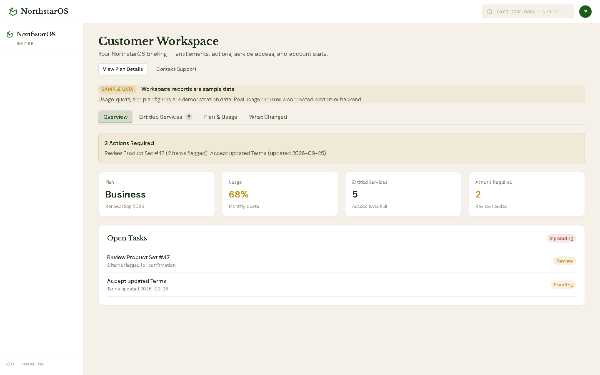
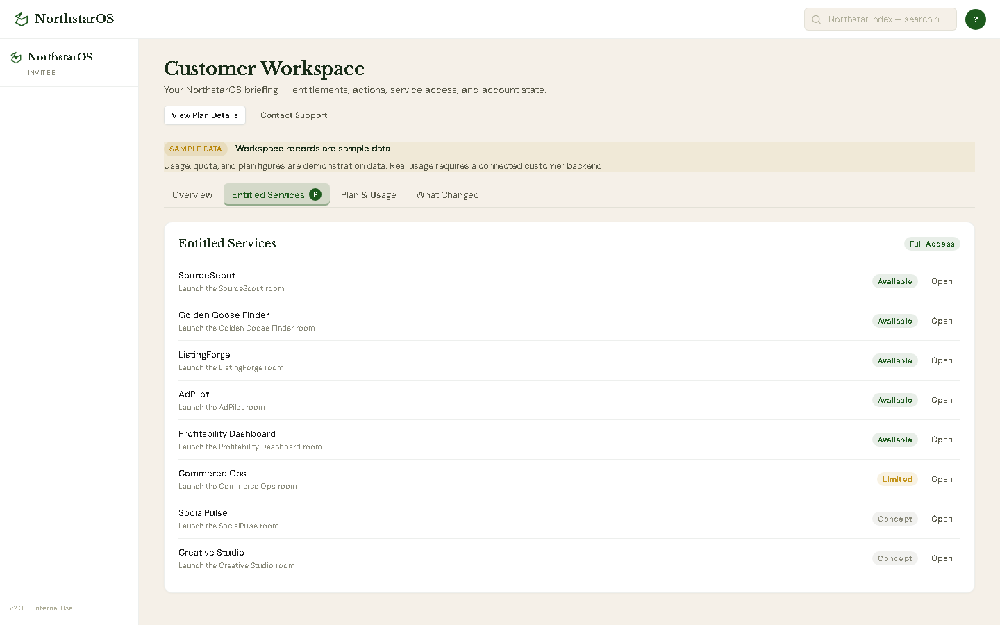
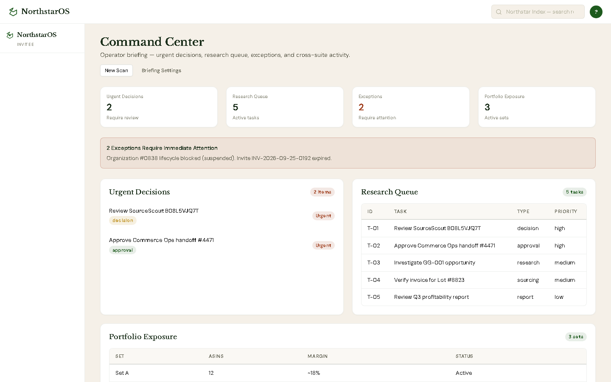
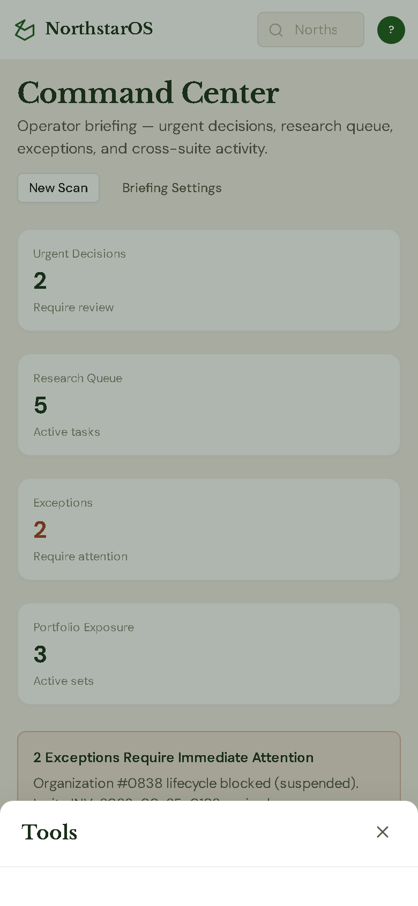
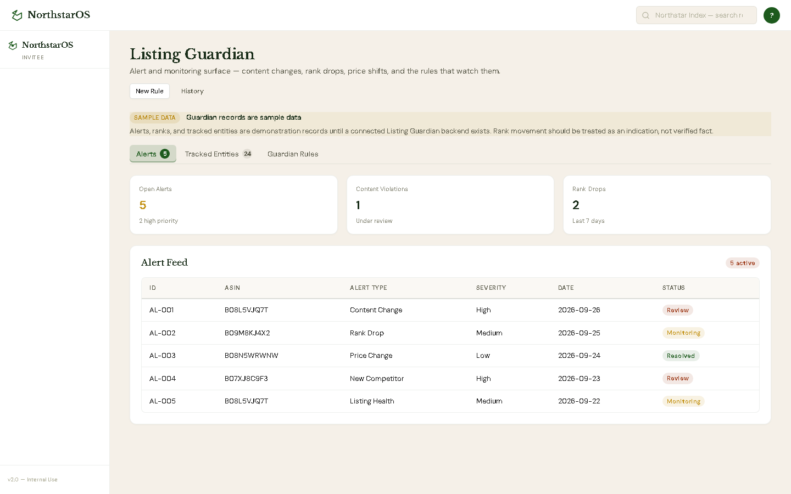
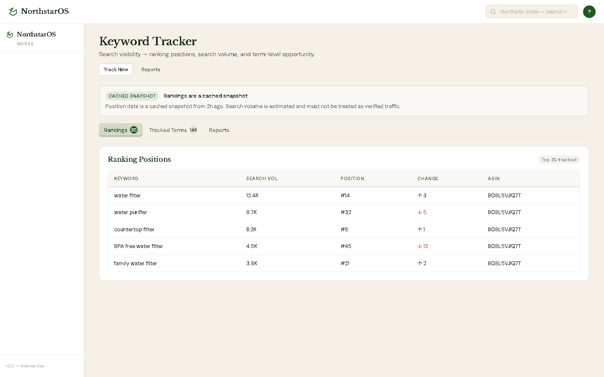
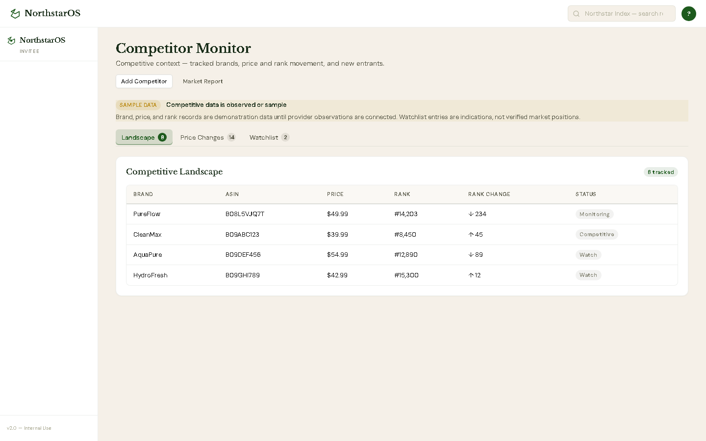
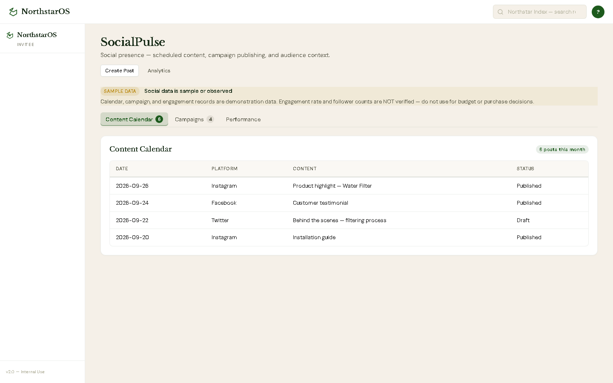
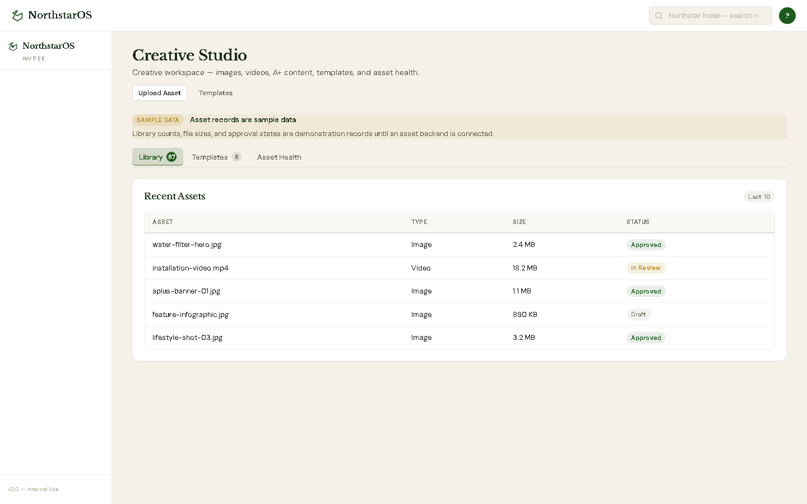

# ui-pages — review pack, 20261109

This slice of `staging-candidate/20261109-0158` touches 165 commit(s) ahead of `main` and changes **74 path(s)**, 74 of which render. It is refused for auto-promotion (`slice_visual`): a person has to look at these images first.

- candidate `staging-candidate/20261109-0158` @ `433c5d87d5ef`
- target `main` @ `ecef24a75d92`

## Gates

| gate | result | evidence |
|---|---|---|
| suite | FAIL | candidate staging-candidate/20261109-0158 = 433c5d87d5ef summary: 32 failed, 7189 passed, 125 skipped, 2 xfailed, 17 warning, 125 subtests |
| verifier | PASS | d15_verification.md: 17 agree, 2 FAILED, 1 BLOCKED reproduced by: not recorded (--verifier not given) |
| slice | FAIL | slice ui-pages: 74 path(s), 0 image(s) rendering paths: 74 |

Refused by: `suite`, `slice`

## Images (10 of 5–10)

Slice images first, then committed evidence as context. `before` shows the same path on the target branch; a blank before means the file is new here.

| after (this slice) | before | where |
|---|---|---|
| `northstar-os-ui/screenshots/1-command-center.png`<br> | _new here_ | context |
| `northstar-os-ui/screenshots/10-customer-workspace.png`<br> | _new here_ | context |
| `northstar-os-ui/screenshots/10b-customer-workspace-services.png`<br> | _new here_ | context |
| `northstar-os-ui/screenshots/11-beta-ops.png`<br> | _new here_ | context |
| `northstar-os-ui/screenshots/12-mobile-tools-sheet.png`<br> | _new here_ | context |
| `northstar-os-ui/screenshots/13-listing-guardian.png`<br> | _new here_ | context |
| `northstar-os-ui/screenshots/14-keyword-tracker.png`<br> | _new here_ | context |
| `northstar-os-ui/screenshots/15-competitor-monitor.png`<br> | _new here_ | context |
| `northstar-os-ui/screenshots/16-socialpulse.png`<br> | _new here_ | context |
| `northstar-os-ui/screenshots/17-creative-studio.png`<br> | _new here_ | context |

## Scorecard delta

`ty/scorecards.json` is **absent on `main`** — every score is new.

at_bar **2**: hub, prospector

| service | score | at bar |
|---|---|---|
| hub | 100 | yes |
| prospector | 100 | yes |
| ledger | 86.2 | no |
| auctioneer | 86.2 | no |
| autothink | 86.2 | no |
| thewatch | 86.2 | no |
| rankledger | 86.2 | no |
| rivalboard | 86.2 | no |
| account | 86.2 | no |
| foundation | 86.2 | no |
| jobs | 86.2 | no |
| keywords | 86.2 | no |

## Changed paths (74)

```
northstar-os-ui/src/pages/Account.jsx
northstar-os-ui/src/pages/Auctioneer.jsx
northstar-os-ui/src/pages/Autothink.jsx
northstar-os-ui/src/pages/GoldenGoose.jsx
northstar-os-ui/src/pages/Hub.jsx
northstar-os-ui/src/pages/Ledger.jsx
northstar-os-ui/src/pages/NotFound.jsx
northstar-os-ui/src/pages/Prospector.jsx
northstar-os-ui/src/pages/admin/BetaOpsNav.jsx
northstar-os-ui/src/pages/admin/Cohorts.jsx
northstar-os-ui/src/pages/admin/InviteCreate.jsx
northstar-os-ui/src/pages/admin/OrgsList.jsx
northstar-os-ui/src/pages/admin/Overview.jsx
northstar-os-ui/src/pages/customer/AccountStatus.jsx
northstar-os-ui/src/pages/customer/Documents.jsx
northstar-os-ui/src/pages/customer/Downgraded.jsx
northstar-os-ui/src/pages/customer/Legal.jsx
northstar-os-ui/src/pages/customer/PlanUsage.jsx
northstar-os-ui/src/pages/customer/Reaccept.jsx
northstar-os-ui/src/pages/customer/Setup.jsx
northstar-os-ui/src/pages/customer/Support.jsx
northstar-os-ui/src/pages/customer/Suspended.jsx
northstar-os-ui/src/pages/customer/Workspace.jsx
northstar-os-ui/src/pages/internal/AdPilot.jsx
northstar-os-ui/src/pages/internal/Admin.jsx
northstar-os-ui/src/pages/internal/AutothinK.jsx
northstar-os-ui/src/pages/internal/ChromeConnect.jsx
northstar-os-ui/src/pages/internal/CommandCenter.jsx
northstar-os-ui/src/pages/internal/CommerceOps.jsx
northstar-os-ui/src/pages/internal/CompetitorMonitor.jsx
northstar-os-ui/src/pages/internal/CreativeStudio.jsx
northstar-os-ui/src/pages/internal/DesignStudio.jsx
northstar-os-ui/src/pages/internal/GalacticDeck.jsx
northstar-os-ui/src/pages/internal/GildedVoid.jsx
northstar-os-ui/src/pages/internal/GoldenGoose.jsx
northstar-os-ui/src/pages/internal/Improvement.jsx
northstar-os-ui/src/pages/internal/KeywordTracker.jsx
northstar-os-ui/src/pages/internal/ListingForge.jsx
northstar-os-ui/src/pages/internal/ListingGuardian.jsx
northstar-os-ui/src/pages/internal/MasterBrain.jsx
northstar-os-ui/src/pages/internal/MemoryBank.jsx
northstar-os-ui/src/pages/internal/Monitoring.jsx
northstar-os-ui/src/pages/internal/PackifyDesign.jsx
northstar-os-ui/src/pages/internal/ProductDesigner.jsx
northstar-os-ui/src/pages/internal/ProductFinder.jsx
northstar-os-ui/src/pages/internal/ProfitabilityDashboard.jsx
northstar-os-ui/src/pages/internal/ProviderAdapters.jsx
northstar-os-ui/src/pages/internal/SharedDataLayer.jsx
northstar-os-ui/src/pages/internal/SocialPulse.jsx
northstar-os-ui/src/pages/internal/SpreadsheetLab.jsx
northstar-os-ui/src/pages/internal/TysOpsPanel.jsx
northstar-os-ui/src/pages/internal/design-studio/APlus.jsx
northstar-os-ui/src/pages/internal/design-studio/Ads.jsx
northstar-os-ui/src/pages/internal/design-studio/AmazonFiles.jsx
northstar-os-ui/src/pages/internal/design-studio/AplusLayoutPreview.jsx
northstar-os-ui/src/pages/internal/design-studio/CanvasWorkspace.jsx
northstar-os-ui/src/pages/internal/design-studio/CompositingSurface.jsx
northstar-os-ui/src/pages/internal/design-studio/Deliverables.jsx
northstar-os-ui/src/pages/internal/design-studio/Dielines.jsx
northstar-os-ui/src/pages/internal/design-studio/IndexingRegister.jsx
northstar-os-ui/src/pages/internal/design-studio/ListingImages.jsx
northstar-os-ui/src/pages/internal/design-studio/Packaging.jsx
northstar-os-ui/src/pages/internal/design-studio/SearchTerms.jsx
northstar-os-ui/src/pages/internal/design-studio/SectionWorkspace.jsx
northstar-os-ui/src/pages/internal/design-studio/Social.jsx
northstar-os-ui/src/pages/internal/design-studio/Storefront.jsx
northstar-os-ui/src/pages/internal/design-studio/VideoUgc.jsx
northstar-os-ui/src/pages/internal/ppc/PpcHarvest.jsx
northstar-os-ui/src/pages/internal/research/ResearchDesk.jsx
northstar-os-ui/src/pages/public/BetaInviteAccept.jsx
northstar-os-ui/src/pages/public/BetaLanding.jsx
northstar-os-ui/src/pages/public/Recovery.jsx
northstar-os-ui/src/pages/public/SignIn.jsx
northstar-os-ui/src/pages/roomAdapters.jsx
```

## Commands

Promote just this slice:

```
python tools/promote_staging.py --source staging-candidate/20261109-0158 --slice ui-pages --promote --candidate staging-candidate/20261109-0158 --approve-visual "<what you looked at and accepted>"
```

Revert it:

```
python tools/promote_staging.py --slice ui-pages --revert promote/20261109-ui-pages-433c5d87
```
