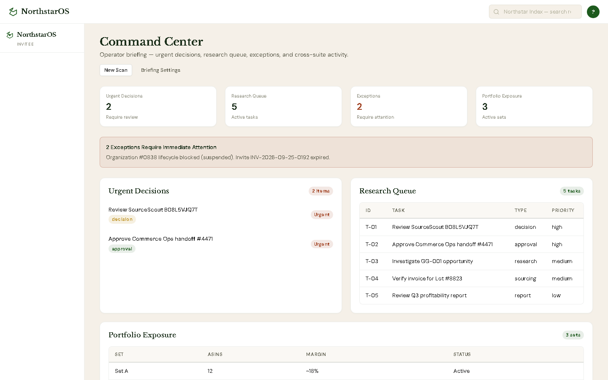
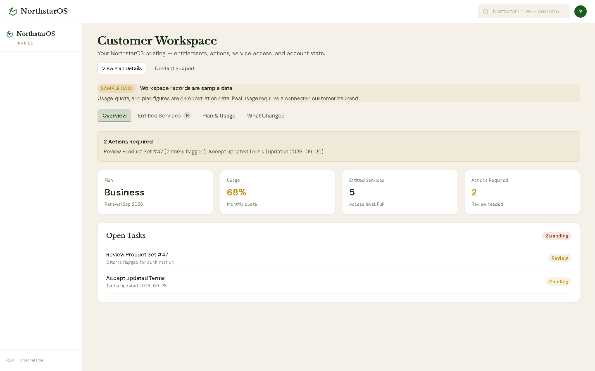
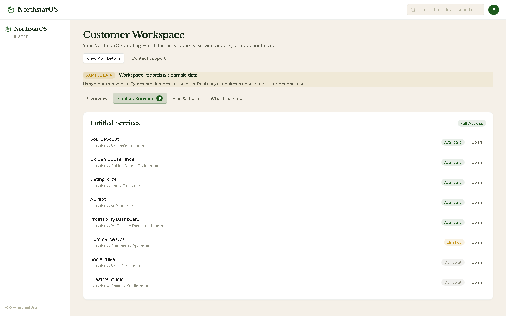
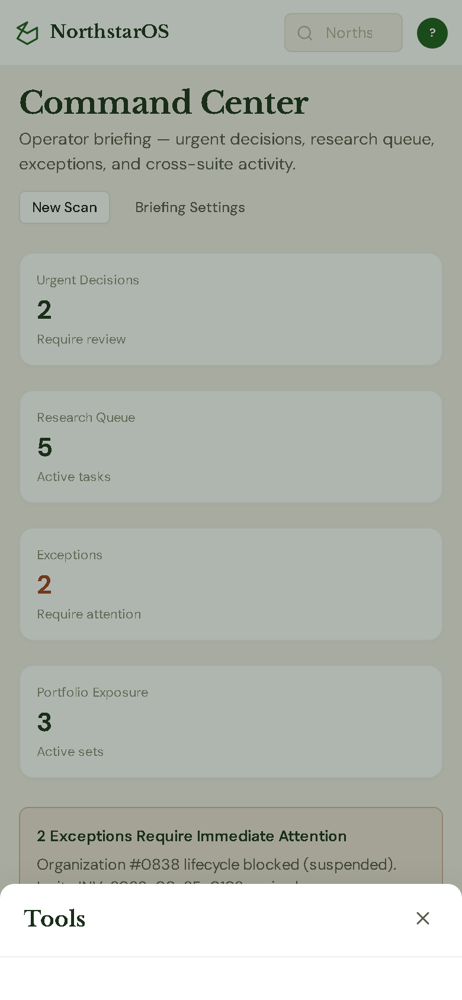
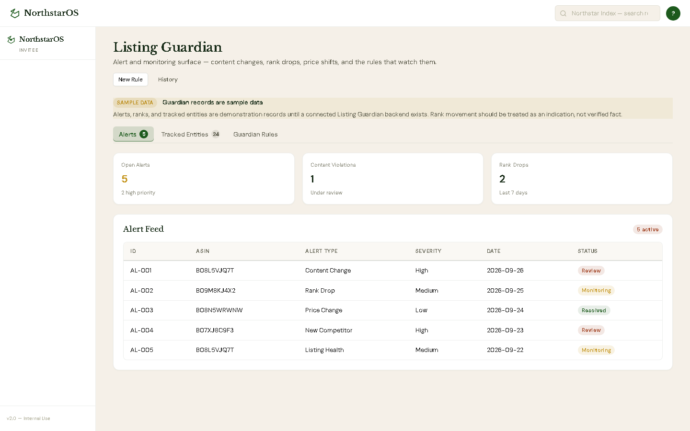
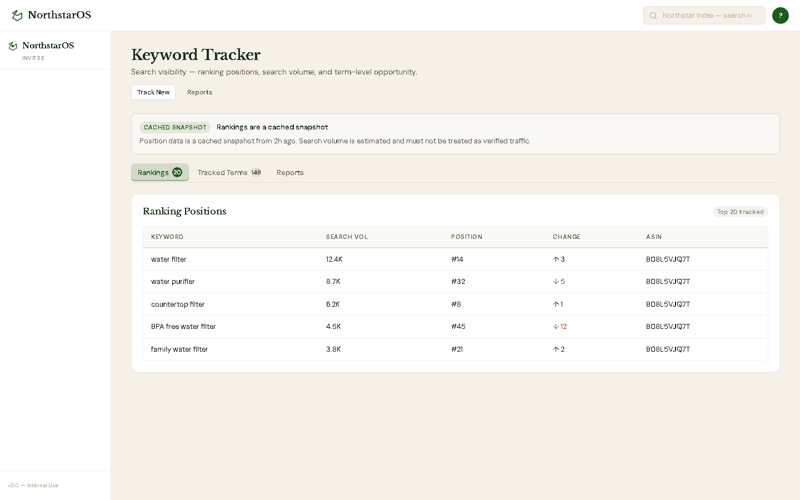
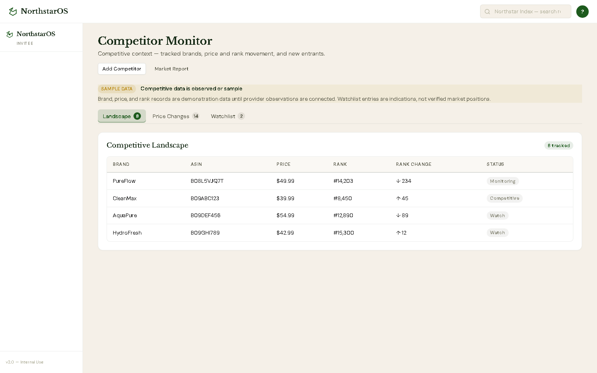
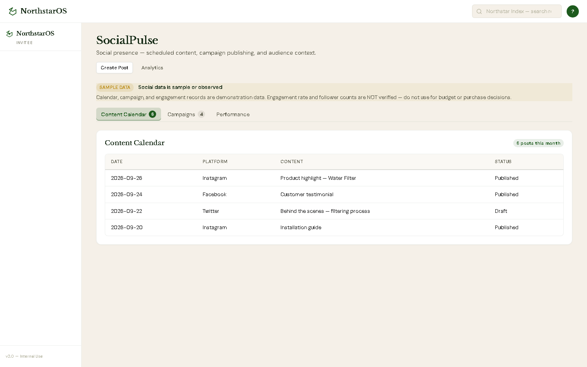
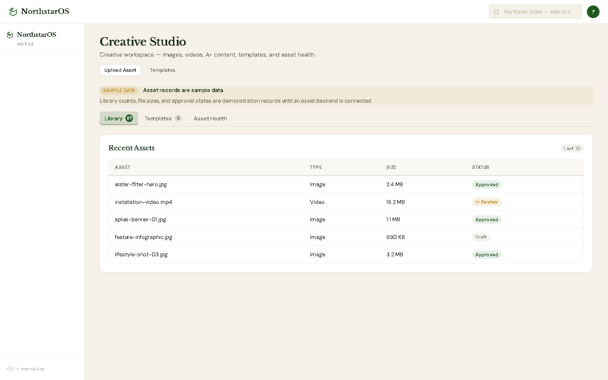

# ui-shell — review pack, 20261109

This slice of `staging-candidate/20261109-0158` touches 31 commit(s) ahead of `main` and changes **15 path(s)**, 15 of which render. It is refused for auto-promotion (`slice_visual`): a person has to look at these images first.

- candidate `staging-candidate/20261109-0158` @ `433c5d87d5ef`
- target `main` @ `ecef24a75d92`

## Gates

| gate | result | evidence |
|---|---|---|
| suite | FAIL | candidate staging-candidate/20261109-0158 = 433c5d87d5ef summary: 32 failed, 7189 passed, 125 skipped, 2 xfailed, 17 warning, 125 subtests |
| verifier | PASS | d15_verification.md: 17 agree, 2 FAILED, 1 BLOCKED reproduced by: not recorded (--verifier not given) |
| slice | FAIL | slice ui-shell: 15 path(s), 0 image(s) rendering paths: 15 |

Refused by: `suite`, `slice`

## Images (10 of 5–10)

Slice images first, then committed evidence as context. `before` shows the same path on the target branch; a blank before means the file is new here.

| after (this slice) | before | where |
|---|---|---|
| `northstar-os-ui/screenshots/1-command-center.png`<br> | _new here_ | context |
| `northstar-os-ui/screenshots/10-customer-workspace.png`<br> | _new here_ | context |
| `northstar-os-ui/screenshots/10b-customer-workspace-services.png`<br> | _new here_ | context |
| `northstar-os-ui/screenshots/11-beta-ops.png`<br> | _new here_ | context |
| `northstar-os-ui/screenshots/12-mobile-tools-sheet.png`<br> | _new here_ | context |
| `northstar-os-ui/screenshots/13-listing-guardian.png`<br> | _new here_ | context |
| `northstar-os-ui/screenshots/14-keyword-tracker.png`<br> | _new here_ | context |
| `northstar-os-ui/screenshots/15-competitor-monitor.png`<br> | _new here_ | context |
| `northstar-os-ui/screenshots/16-socialpulse.png`<br> | _new here_ | context |
| `northstar-os-ui/screenshots/17-creative-studio.png`<br> | _new here_ | context |

## Scorecard delta

`ty/scorecards.json` is **absent on `main`** — every score is new.

at_bar **2**: hub, prospector

| service | score | at bar |
|---|---|---|
| hub | 100 | yes |
| prospector | 100 | yes |
| ledger | 86.2 | no |
| auctioneer | 86.2 | no |
| autothink | 86.2 | no |
| thewatch | 86.2 | no |
| rankledger | 86.2 | no |
| rivalboard | 86.2 | no |
| account | 86.2 | no |
| foundation | 86.2 | no |
| jobs | 86.2 | no |
| keywords | 86.2 | no |

## Changed paths (15)

```
northstar-os-ui/src/shell/CelestialBackdrop.jsx
northstar-os-ui/src/shell/CommandMenu.jsx
northstar-os-ui/src/shell/CosmicCanvas.jsx
northstar-os-ui/src/shell/GalacticBackdrop.jsx
northstar-os-ui/src/shell/HardwareModal.jsx
northstar-os-ui/src/shell/MasterBrainShell.jsx
northstar-os-ui/src/shell/SettingsModal.jsx
northstar-os-ui/src/shell/ShellContext.jsx
northstar-os-ui/src/shell/WorkbenchShell.jsx
northstar-os-ui/src/shell/WorkspaceTabs.jsx
northstar-os-ui/src/shell/api.js
northstar-os-ui/src/shell/galacticShader.js
northstar-os-ui/src/shell/galacticVariants.js
northstar-os-ui/src/shell/simpleDesigns.js
northstar-os-ui/src/shell/vistas.js
```

## Commands

Promote just this slice:

```
python tools/promote_staging.py --source staging-candidate/20261109-0158 --slice ui-shell --promote --candidate staging-candidate/20261109-0158 --approve-visual "<what you looked at and accepted>"
```

Revert it:

```
python tools/promote_staging.py --slice ui-shell --revert promote/20261109-ui-shell-433c5d87
```
