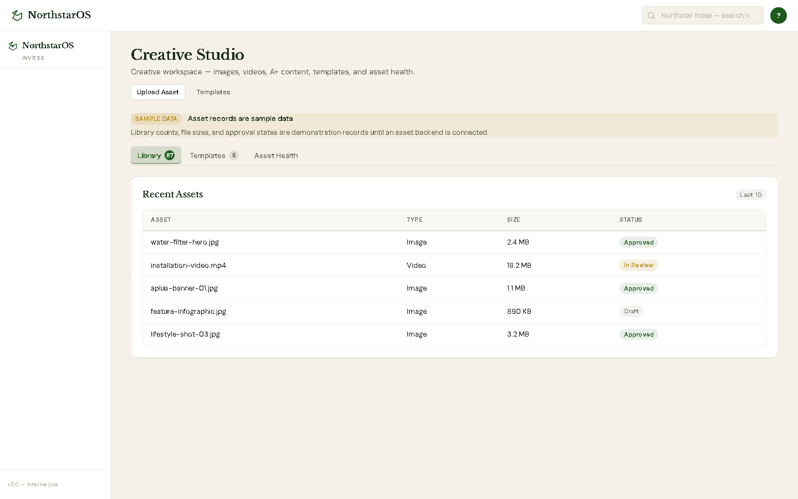
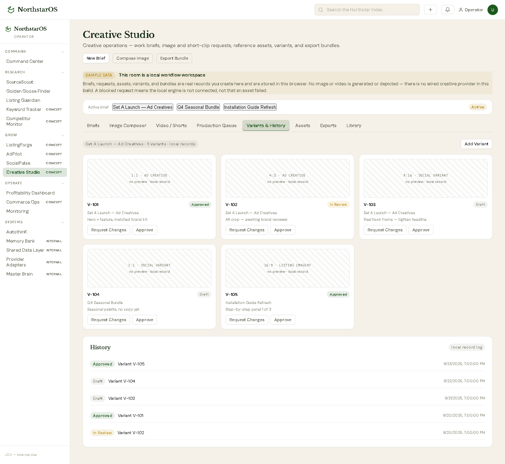
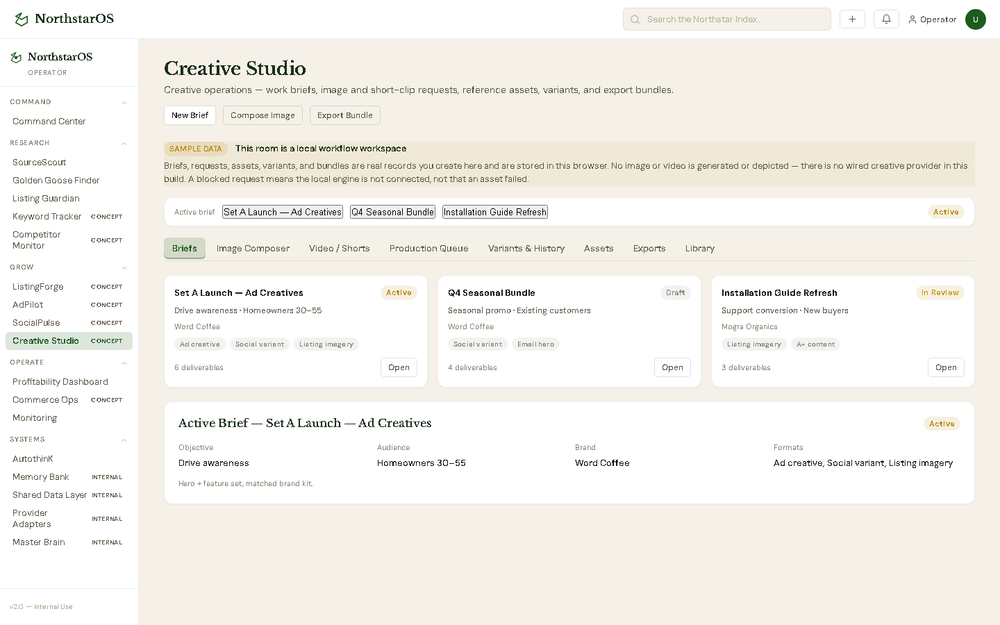
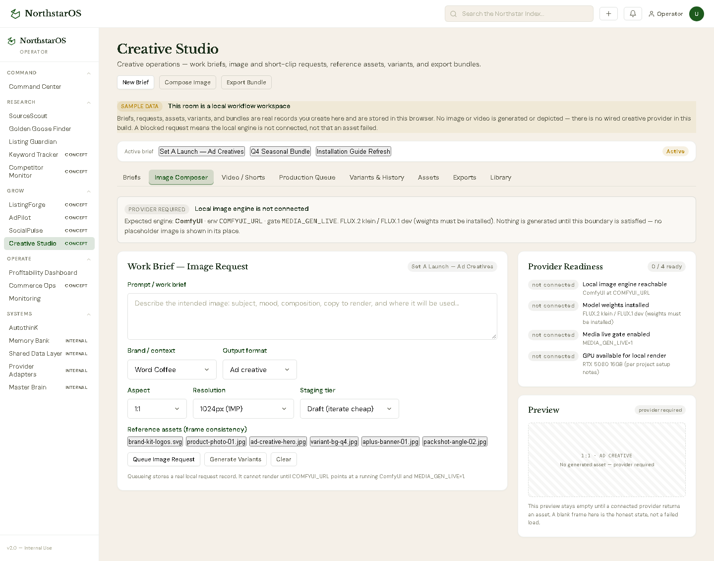
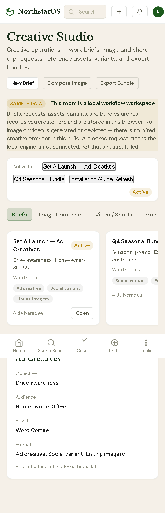
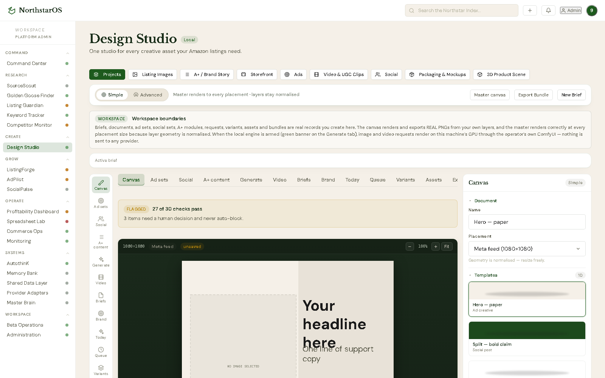
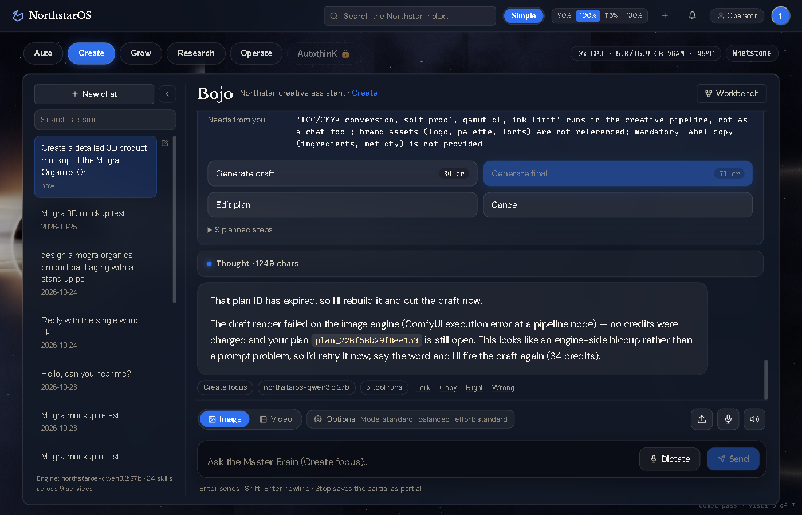
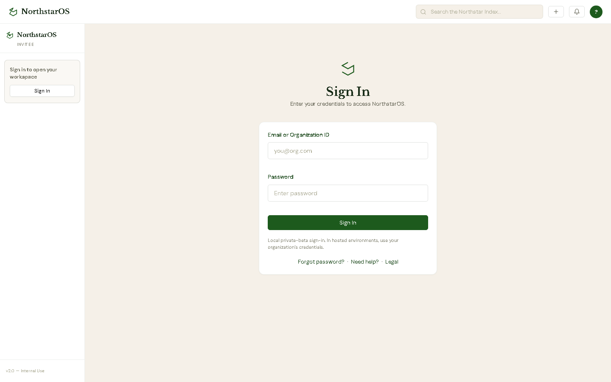
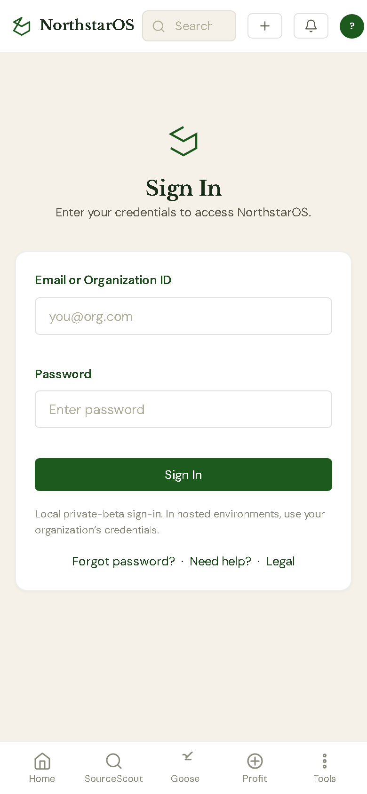

# ui-studio — review pack, 20261109

This slice of `staging-candidate/20261109-0158` touches 35 commit(s) ahead of `main` and changes **35 path(s)**, 35 of which render. It is refused for auto-promotion (`slice_visual`): a person has to look at these images first.

- candidate `staging-candidate/20261109-0158` @ `433c5d87d5ef`
- target `main` @ `ecef24a75d92`

## Gates

| gate | result | evidence |
|---|---|---|
| suite | FAIL | candidate staging-candidate/20261109-0158 = 433c5d87d5ef summary: 32 failed, 7189 passed, 125 skipped, 2 xfailed, 17 warning, 125 subtests |
| verifier | PASS | d15_verification.md: 17 agree, 2 FAILED, 1 BLOCKED reproduced by: not recorded (--verifier not given) |
| slice | FAIL | slice ui-studio: 35 path(s), 0 image(s) rendering paths: 35 |

Refused by: `suite`, `slice`

## Images (10 of 5–10)

Slice images first, then committed evidence as context. `before` shows the same path on the target branch; a blank before means the file is new here.

| after (this slice) | before | where |
|---|---|---|
| `northstar-os-ui/screenshots/17-creative-studio.png`<br> | _new here_ | context |
| `northstar-os-ui/screenshots/sessionB-creative-social-20260930/creative-studio-desktop-populated-workflow.png`<br> | _new here_ | context |
| `northstar-os-ui/screenshots/sessionB-creative-social-20260930/creative-studio-desktop-primary.png`<br> | _new here_ | context |
| `northstar-os-ui/screenshots/sessionB-creative-social-20260930/creative-studio-desktop-provider-required.png`<br> | _new here_ | context |
| `northstar-os-ui/screenshots/sessionB-creative-social-20260930/creative-studio-mobile-primary.png`<br> | _new here_ | context |
| `reports/ui_review_20261016/shots/03-design-studio.png`<br> | _new here_ | context |
| `reports/real-verify-2026-10-26/screenshots/explore-design-studio.png`<br> | _new here_ | context |
| `reports/screenshots_20261009/desktop-20-creative-studio-tabs.png`<br> | _new here_ | context |
| `reports/screenshots_20261009/desktop-20-creative-studio.png`<br> | _new here_ | context |
| `reports/screenshots_20261009/mobile-20-creative-studio.png`<br> | _new here_ | context |

## Scorecard delta

`ty/scorecards.json` is **absent on `main`** — every score is new.

at_bar **2**: hub, prospector

| service | score | at bar |
|---|---|---|
| hub | 100 | yes |
| prospector | 100 | yes |
| ledger | 86.2 | no |
| auctioneer | 86.2 | no |
| autothink | 86.2 | no |
| thewatch | 86.2 | no |
| rankledger | 86.2 | no |
| rivalboard | 86.2 | no |
| account | 86.2 | no |
| foundation | 86.2 | no |
| jobs | 86.2 | no |
| keywords | 86.2 | no |

## Changed paths (35)

```
northstar-os-ui/src/studio/aplus/AplusModules.jsx
northstar-os-ui/src/studio/aplus/aplus.css
northstar-os-ui/src/studio/aplus/metrics.js
northstar-os-ui/src/studio/components/Chrome.jsx
northstar-os-ui/src/studio/components/Fields.jsx
northstar-os-ui/src/studio/components/MasterBrainPanel.jsx
northstar-os-ui/src/studio/components/Stage.jsx
northstar-os-ui/src/studio/components/StudioShell.jsx
northstar-os-ui/src/studio/engine/adDoc.js
northstar-os-ui/src/studio/engine/assets.js
northstar-os-ui/src/studio/engine/compliance.js
northstar-os-ui/src/studio/engine/compose.js
northstar-os-ui/src/studio/engine/disclosure.js
northstar-os-ui/src/studio/engine/doc.js
northstar-os-ui/src/studio/engine/engineApi.js
northstar-os-ui/src/studio/engine/fidelity.js
northstar-os-ui/src/studio/engine/generation.js
northstar-os-ui/src/studio/engine/hookTemplates.js
northstar-os-ui/src/studio/engine/imports.js
northstar-os-ui/src/studio/engine/indexing.js
northstar-os-ui/src/studio/engine/listingContext.js
northstar-os-ui/src/studio/engine/loop.js
northstar-os-ui/src/studio/engine/migrate.js
northstar-os-ui/src/studio/engine/mockups.js
northstar-os-ui/src/studio/engine/outputPacks.js
northstar-os-ui/src/studio/engine/presets.js
northstar-os-ui/src/studio/engine/rechecks.js
northstar-os-ui/src/studio/engine/registryClaims.js
northstar-os-ui/src/studio/engine/render3d.js
northstar-os-ui/src/studio/engine/sceneDoc.js
northstar-os-ui/src/studio/engine/socialDoc.js
northstar-os-ui/src/studio/engine/specRegistry.js
northstar-os-ui/src/studio/engine/store.js
northstar-os-ui/src/studio/engine/three.js
northstar-os-ui/src/studio/engine/variants.js
```

## Commands

Promote just this slice:

```
python tools/promote_staging.py --source staging-candidate/20261109-0158 --slice ui-studio --promote --candidate staging-candidate/20261109-0158 --approve-visual "<what you looked at and accepted>"
```

Revert it:

```
python tools/promote_staging.py --slice ui-studio --revert promote/20261109-ui-studio-433c5d87
```
